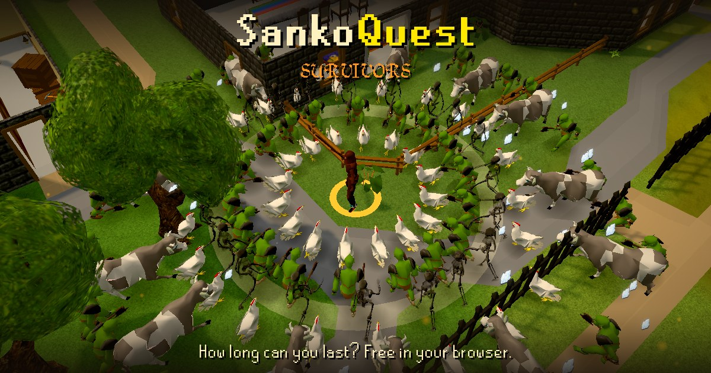

<p align="center">
  
</p>

<h1 align="center">SankoQuest Survivors</h1>

<p align="center">
  A survivors-style fan game set in the real SankoQuest world.<br>
  Hold out for 15 minutes, or slay the boss.<br><br>
  <a href="https://sankosurvivors.quest"><b>▶ Play at sankosurvivors.quest</b></a>
</p>

<p align="center">
  Made by <a href="https://x.com/dexedrne">@dexedrne</a> for the Sanko community ·
  <a href="https://t.me/sankogamecorp">Telegram</a> · <a href="https://x.com/SankoGameCorp">X</a>
</p>

---

Hey Sanko team 👋 thanks for checking it out. Here's what's in it:

- **The real world.** SankoQuest's own map, buildings, trees, NPCs, gear and sounds, taken from the game itself.
- **9 maps** with their own monsters, bosses and events. There are 25 monsters and 5 bosses in all.
- **10 weapons, 13 passives and 10 evolutions.** One passive, the Pumpkin Head, is a curse: more and tougher monsters, for more kills (casual only). Weapons climb the metal tiers from Bronze to Runite.
- **Ranked weekly runs** for $DMT on Arbitrum. One map a week, everyone starts equal, and every run is replayed on the server so only real play counts.
- Leaderboards, quests, gear from reward caskets, and permanent upgrades bought with coins.
- It plays on desktop and phones, and installs like an app.

## Run it

```sh
npm install
npm run dev     # http://127.0.0.1:5174
npm test
```

## Where things live

| | |
|---|---|
| `src/sim.js` | The game rules. They're deterministic, so a ranked run replays exactly. |
| `src/render.js` | Everything you see (three.js). |
| `src/main.js` | Menus, HUD and the game loop. |
| `src/content.js` | Weapons, passives, monsters, maps and gear. |
| `src/ranked.js` | Ranked weeks, run recording and replay. |
| `tools/vercel-api/` | The server: leaderboard, bug reports, DMT holder check and ranked. |
| `tools/supabase/` | Database functions. |
| `tools/deploy.sh` | Builds and deploys to Vercel. |

## Say hi

Found a bug? Use **More → Report a bug** in the game, or ping [@dexedrne](https://x.com/dexedrne).

<sub>An unofficial fan game, made with Sanko GameCorp's blessing. SankoQuest and its art, models, music and characters belong to Sanko GameCorp.</sub>
